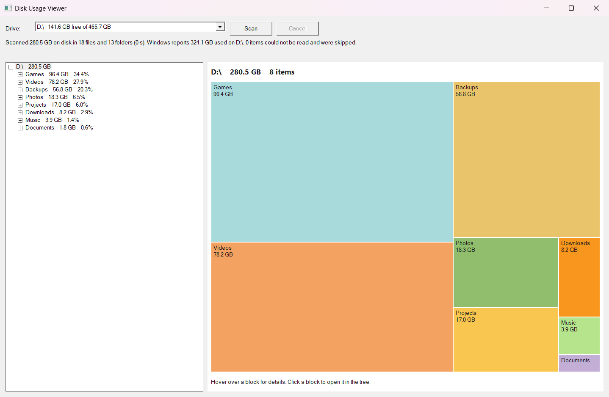

# Disk Usage Viewer

A small Windows app that shows how much space each folder and file on a drive uses. The left pane is a tree you expand one folder at a time; the right pane is a treemap, where each block's area is proportional to its size.

It is a native Win32 and Rust rewrite of an earlier Python version. It ships as one portable `.exe`, with no installer and no administrator rights needed.

*Sample data from a demo build, not a real drive.*

## Use it

1. Download `DiskUsageViewer.exe` from the [Releases](https://github.com/Tom1tk/DiskUsageViewer/releases) page and run it.
2. Pick a drive and press **Scan**. **Cancel** stops a scan.
3. Expand folders in the tree. In the treemap, hover a block for its details, and click it to show it in the tree.

Folders that Windows will not let you read are skipped and counted in the status line.

Sizes are size on disk (the space allocated), not file length. Hard links count once. Symbolic links and junctions are not followed. Files that exist only in the cloud (for example OneDrive online-only files) count as 0.

### Command line

- `DiskUsageViewer.exe --autostart` starts a scan of the selected drive when the window opens.
- `DiskUsageViewer.exe --scan C:\` scans without a window and prints the scan time, the totals and the ten largest top-level entries to the parent console.

## Build

You need Windows 10 or 11, the Rust toolchain for the MSVC target (install with [rustup](https://rustup.rs)), and the Visual Studio C++ build tools.

- `build.bat` runs `cargo build --release` and copies the result to `DiskUsageViewer.exe` in this folder.
- `cargo test` runs the unit tests.

The C runtime is linked statically, so the exe runs without extra redistributables.

## How it scans

- It reads directories with the NT native API, so one listing returns names, attributes, sizes and file IDs.
- It scans in parallel: up to 16 threads, or 2 when the drive reports a seek penalty (a spinning disk).
- Results appear when the scan finishes.

## Source

| File | Purpose |
|---|---|
| `src/main.rs` | Entry point and command-line options |
| `src/app.rs` | Main window, drive list, scan control |
| `src/scan.rs` | Parallel directory scanner |
| `src/nt.rs` | NT native directory-listing bindings |
| `src/tree.rs` | Compact size tree and totals |
| `src/tree_view.rs` | Lazy tree control |
| `src/treemap.rs` | Squarified treemap layout |
| `src/treemap_view.rs` | Treemap window (drawing and hover) |
| `src/disk.rs` | Drive list, free space, seek-penalty query |
| `src/format.rs` | Size and number formatting |
| `src/win.rs` | Small Win32 helpers |

The design decisions and the verification log are in [tasks/todo.md](tasks/todo.md).

## Known limits

- No progressive display: results appear when a scan finishes.
- Results are not saved between runs, and the tree does not update when files change.
- The seek-penalty thread choice has not been tested on a spinning disk.
- Cold-cache scan speed has not been measured.

## About this project

This was a test of Claude Haiku 5.5 working in Rust through Claude Code. The app is a native Win32 rewrite of an earlier Python version.
